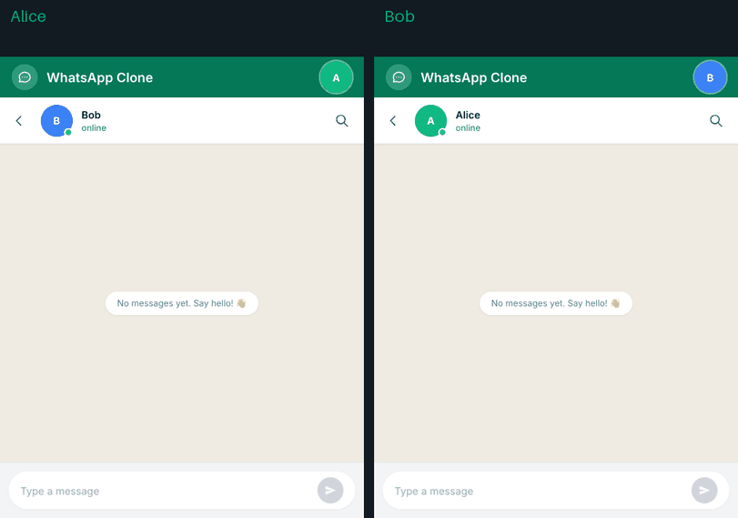
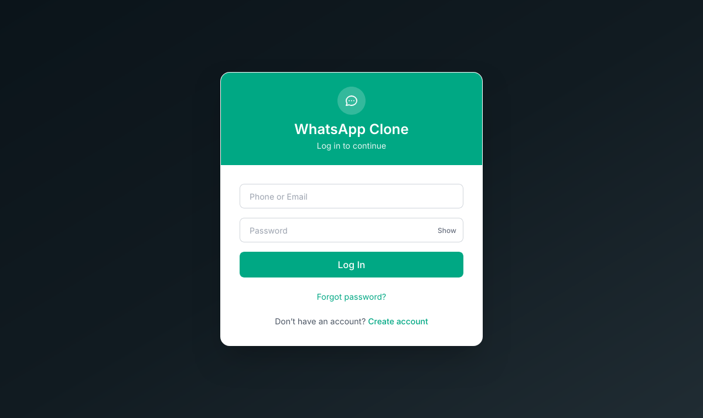
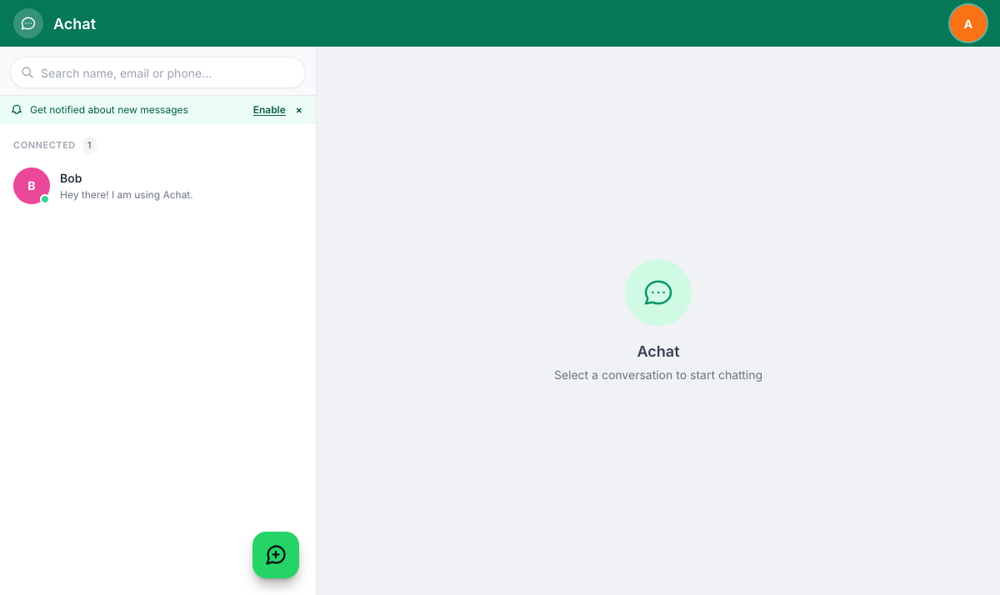
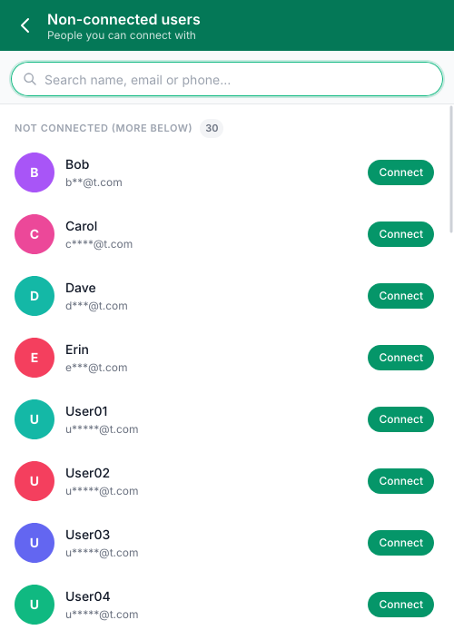
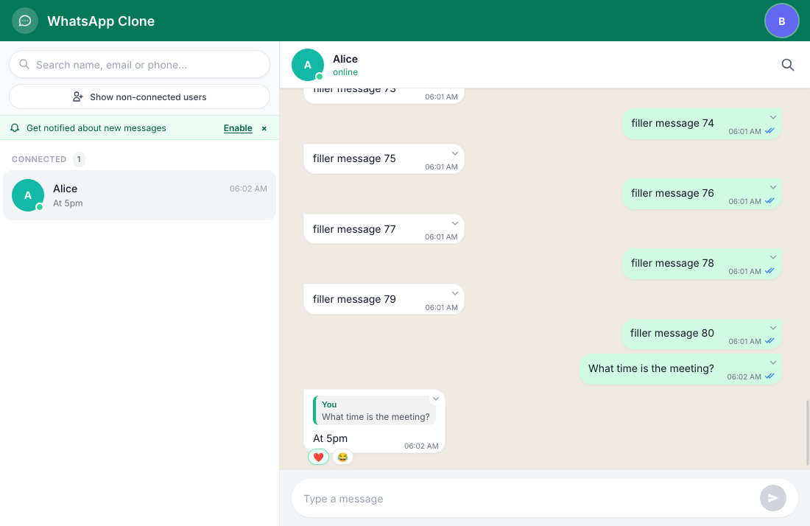
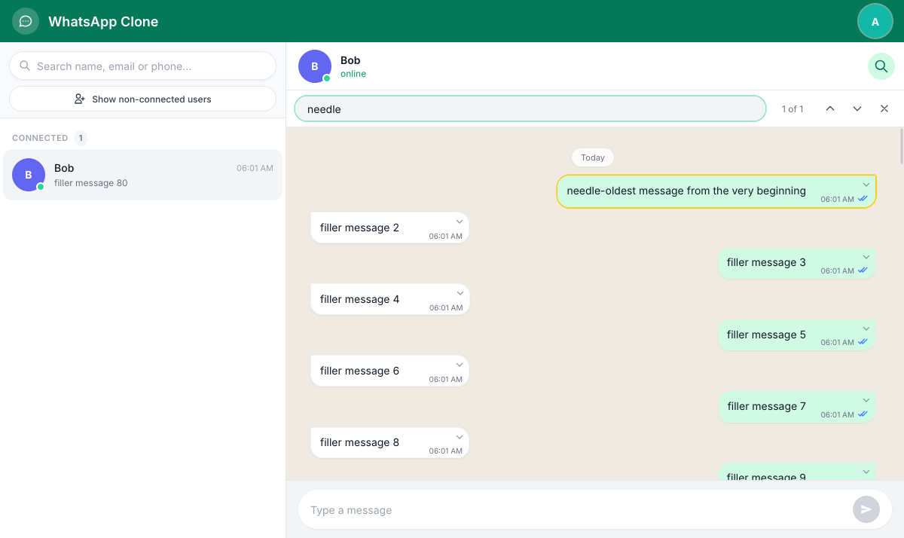
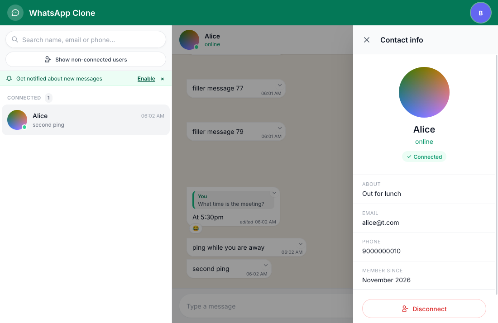
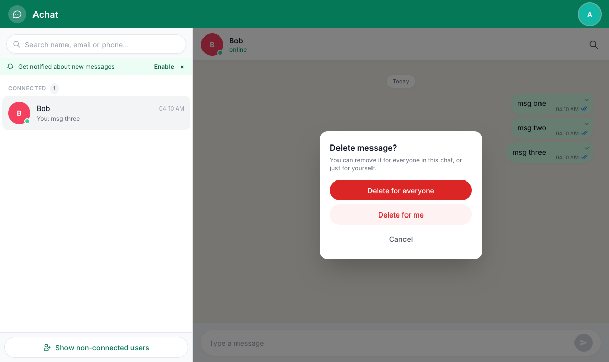
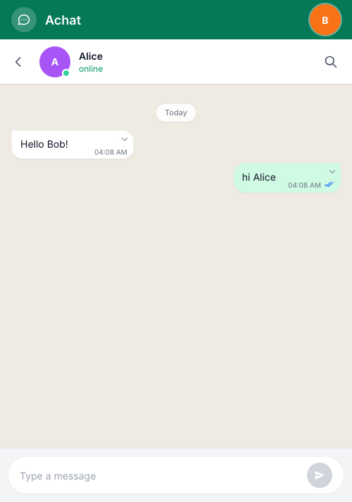
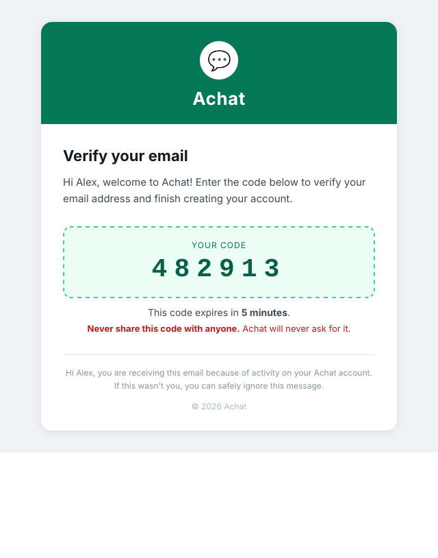

# Achat

A real-time chat app built with **React 19 + TypeScript + Tailwind** on the front and **Express 5 + MongoDB + Socket.io** on the back.



## Project layout

| Folder | What it is |
|---|---|
| [`backend/`](backend) | API: Express 5, MongoDB, Socket.io, tests |
| [`frontend/`](frontend) | Web app: React 19, TypeScript, Vite, Tailwind |
| [`mobile/`](mobile) | Android app: a Capacitor shell that packages the frontend (same features, one codebase) |

Each folder is an independent npm project with its own `package.json`. GitHub Actions in `.github/workflows` tests all three and builds the APK.

## Features

**Accounts**
- Sign up with email OTP verification, log in with email or phone, forgot / reset password, **Continue with Google** (website and Android app)
- All emails (codes, welcome, password changed) are sent through **EmailJS** with one ready-made template
- Profile picture (resized in the browser, stored in MongoDB) and an "About" line
- Block and unblock people

**Finding people**
- **Connected accounts** is the home page: only people you're connected with, each with last message, time and an unread badge
- Live **search** by name, email or phone
- **Floating green button** (like "new chat") in the chat list opens a separate **Non-connected users** page: search everyone you haven't connected with, with a Connect button for each and "Show more" paging
- Connection requests: send, cancel, accept, reject, disconnect

**Chatting**
- Real time delivery, delivered / read ticks, typing indicator, online and last seen
- **Reply** to a message (tap the quote to jump to the original)
- **Emoji reactions** (one per person, tap yours to remove it)
- **Edit** a sent message (15 minute window, shows "edited")
- **Delete for me** or **delete for everyone** (the stored text is erased)
- **Search inside a chat**, with next / previous match and jump to old messages
- Paginated history (latest 50, older pages load as you scroll up)
- Desktop notifications and an unread count in the tab title: `(3) Achat`
- Dark mode, mobile layout
- **Android app** (APK) built automatically by GitHub from the same code, see [Android app](#android-app)

## Screenshots

| | |
|---|---|
|  |  |
|  |  |
|  |  |
|  |  |

## Setup

Requirements: Node 22+, a MongoDB database (local or Atlas).

```bash
# 1. backend
cd backend
cp .env.example .env      # fill in MONGO_URI, JWT_SECRET, MESSAGE_SECRET (emails: see "Emails with EmailJS")
npm install
npm run dev               # http://localhost:5000

# 2. frontend (new terminal)
cd frontend
cp .env.example .env      # VITE_API_BASE_URL (+ optional VITE_GOOGLE_CLIENT_ID)
npm install
npm run dev               # http://localhost:5173
```

From the repository root you can also use the shortcuts `npm run install:all`, `npm run dev:backend`, `npm run dev:frontend`, `npm test`, `npm run lint`.

`MESSAGE_SECRET` must be 64 hex characters:
`node -e "console.log(require('crypto').randomBytes(32).toString('hex'))"`

### Backend environment variables

| Variable | Required | Purpose |
|---|---|---|
| `MONGO_URI` | yes | MongoDB connection string |
| `JWT_SECRET` | yes | signs login tokens |
| `MESSAGE_SECRET` | yes | 32-byte hex key used to encrypt messages at rest |
| `CLIENT_URL` | yes in production | allowed frontend origin(s), comma separated |
| `EMAILJS_SERVICE_ID`, `EMAILJS_TEMPLATE_ID`, `EMAILJS_PUBLIC_KEY`, `EMAILJS_PRIVATE_KEY` | for emails | see [Emails with EmailJS](#emails-with-emailjs). Empty in development = emails are printed in the terminal |
| `GOOGLE_CLIENT_ID` | no | enables Google sign-in on the website |
| `GOOGLE_CLIENT_SECRET` | for the app | enables Google sign-in in the Android app |
| `BACKEND_PUBLIC_URL` | no | public URL of the API for Google's redirect (auto-detected on Render) |
| `EDIT_WINDOW_MINUTES` | no | how long a message can be edited (default 15) |
| `REDIS_URL` | no | run several backend instances (see below) |
| `KEEP_ALIVE_URL` / `KEEP_ALIVE=false` | no | self-ping control (see below) |
| `TRUST_PROXY` | no | set to `1` behind a reverse proxy |

## Emails with EmailJS

Achat sends five emails: **sign-up code, new code, password-reset code, welcome, password changed**. All of them use one EmailJS template, so setup takes a few minutes:

1. Create a free account at [emailjs.com](https://www.emailjs.com) and connect an email service (for example Gmail) to get a **Service ID**.
2. Create a template, paste [`backend/emailjs/achat-template.html`](backend/emailjs/achat-template.html) into its code editor, set *To Email* to `{{to_email}}` and *Subject* to `{{subject}}`, and note the **Template ID**.
3. Copy your **Public Key**, switch on **"Allow EmailJS API for non-browser applications"** (Account → Security), and optionally copy the **Private Key**.
4. Put the four values in `backend/.env` (and in Render's environment): `EMAILJS_SERVICE_ID`, `EMAILJS_TEMPLATE_ID`, `EMAILJS_PUBLIC_KEY`, `EMAILJS_PRIVATE_KEY`.

The full walkthrough, the variable list, a test payload and a troubleshooting table are in [`backend/emailjs/README.md`](backend/emailjs/README.md). Without these settings local development still works: the email, including its code, is printed in the backend terminal.



## Google sign-in

One Google **Web** OAuth client powers both the website button and the Android app (no SHA-1 / certificate setup is needed).

1. [Google Cloud Console](https://console.cloud.google.com) → **APIs & Services → OAuth consent screen**: create an *External* app and add yourself as a test user (publish it later so anyone can sign in).
2. **Credentials → Create credentials → OAuth client ID → Web application**:
   - *Authorized JavaScript origins:* your website URL (for example `https://your-site.netlify.app`) and `http://localhost:5173`
   - *Authorized redirect URIs:* `https://<your-backend>/api/auth/google/callback`  ← used by the Android app
3. Copy the **Client ID** and **Client secret**, then set:
   - backend (`.env` / Render): `GOOGLE_CLIENT_ID`, `GOOGLE_CLIENT_SECRET`
   - website build (Netlify env): `VITE_GOOGLE_CLIENT_ID` (= the Client ID)
   - Android build (GitHub → Settings → Secrets and variables → Actions → Variables): `GOOGLE_CLIENT_ID` (= the Client ID)

**How it works in the app:** Google does not allow sign-in inside an embedded WebView, so the app opens the system browser. After you pick your account, the backend ends on a page that opens `achat://auth?code=…` and Android returns to the app, which trades that one-time code for a session. The code is protected with PKCE: it only works together with a secret that never leaves the app, and it can be used once within two minutes.

## Android app

The Android app is the **same React code** wrapped in a native shell with [Capacitor](https://capacitorjs.com), so every feature above works in the app and there is only one codebase to maintain. GitHub builds the APK for you whenever you push.

### One-time setup

1. **Deploy the backend over HTTPS** (for example on Render) and note its URL, e.g. `https://your-app.onrender.com`. Android blocks plain `http://` connections.
2. In your GitHub repository open **Settings → Secrets and variables → Actions → Variables tab → New repository variable**:
   - Name: `API_BASE_URL`
   - Value: your backend URL (no trailing slash)
3. Optional: add a second variable `GOOGLE_CLIENT_ID` to show "Continue with Google" in the app (see [Google sign-in](#google-sign-in)).
4. Push to `main` (or open **Actions → Android APK → Run workflow**).

The first build takes several minutes. When it finishes, download the APK from the **`android-latest` release** (Releases page, always the newest build) or from the run's **Artifacts**. Copy it to your phone and open it; Android will ask you to allow "install unknown apps" for your browser or file manager.

The backend already accepts requests from the app. For Google sign-in it also needs `GOOGLE_CLIENT_SECRET` and the redirect URI from the [Google sign-in](#google-sign-in) section.

### Updating

Push again and a new APK is built. It installs **over** the old one (same signing key, higher version number), keeping your login.

### Using your own signing key (recommended before sharing the app)

Out of the box the APK is signed with a key that lives in this repository (`mobile/android/app/achat-debug.keystore`), which is fine for your own phone but is public. To use a private key:

```bash
keytool -genkeypair -v -keystore my-release.keystore -alias achat -keyalg RSA -keysize 2048 -validity 10000
base64 -w0 my-release.keystore      # macOS: base64 -i my-release.keystore
```

Add these as repository **secrets** (Settings → Secrets and variables → Actions → Secrets): `ANDROID_KEYSTORE_BASE64` (the base64 text), `ANDROID_KEYSTORE_PASSWORD`, `ANDROID_KEY_ALIAS` (`achat`) and `ANDROID_KEY_PASSWORD`. **Back the keystore file up**: if you lose it you can never publish an update to the same app. Switching keys means uninstalling the old app once.

### Build it yourself

Needs Node 22, JDK 21 and Android Studio (or the Android SDK).

```bash
echo "VITE_API_BASE_URL=https://your-app.onrender.com" > frontend/.env
npm --prefix frontend install
npm --prefix mobile install
npm run android:open     # builds frontend/, syncs it into mobile/android, opens Android Studio → press Run
npm run android:run      # or run straight on a connected phone / emulator
```

### How the app differs from the website

| | Website | Android app |
|---|---|---|
| Chat, replies, reactions, edit, delete, search, blocking, profile picture | ✅ | ✅ same code |
| Email + OTP login, password reset | ✅ | ✅ |
| "Continue with Google" | ✅ | ✅ opens Google in the system browser, then returns to the app (needs the Google setup above) |
| New-message notifications | browser notifications | system notifications (ask for permission via the green banner); tap one to open the chat |
| Notification while the app is **fully closed** | no | not yet: that needs push (Firebase FCM): a Firebase project, `google-services.json`, and the server sending pushes |
| Back button | browser | closes the open chat, then minimizes the app |
| Reconnects after being in the background | n/a | yes, automatically |

Publishing to the Play Store is not set up (it needs a Google developer account and a signed `.aab`: `cd android && ./gradlew bundleRelease`).

### Troubleshooting

- **The workflow fails with "API_BASE_URL is not set"**: add the repository variable from step 2 above.
- **"App not installed"** when updating: the previous install was signed with a different key. Uninstall it once and install again.
- **Login says it can't reach the server**: the backend must be reachable over `https://`, and on Render's free plan the first request after idle takes up to a minute.
- **The build fails**: open the failed step in the Actions run; the Gradle error is at the bottom of "Build the release APK".

## Tests

```bash
# backend: runs the real app against a real MongoDB (default mongodb://127.0.0.1:27017)
cd backend && npm test

# frontend
cd frontend && npm run lint && npm run typecheck && npm run build
```

The backend suite (auth, connections, blocking, avatars, messaging, replies, reactions, editing, search, pagination, deletion, socket security and presence) starts the actual Express + Socket.io app in-process, so it exercises the same code paths as production. Set `REDIS_URL` to also run the two-instance test. GitHub Actions runs everything on every push (`.github/workflows/ci.yml`).

## Deploying (Netlify + Render)

- **Frontend (Netlify):** base directory `frontend`, build command `npm run build`, publish directory `frontend/dist`, env var `VITE_API_BASE_URL=https://<your-service>.onrender.com`. Vite env vars are baked in at build time, so redeploy after changing them.
- **Backend (Render):** root directory `backend`, build `npm install`, start `npm start`. Set the environment variables above, `CLIENT_URL` to your Netlify URL (no trailing slash) and `TRUST_PROXY=1`.
- **Free tier sleep:** Render's free plan sleeps after ~15 minutes without traffic and the next request takes 30 to 60 seconds. The backend pings its own `/health` every 10 minutes while awake (automatic on Render through `RENDER_EXTERNAL_URL`), and the login screens show a "waking up the server" message when a request is slow. To wake it after a full sleep, add a free [UptimeRobot](https://uptimerobot.com) monitor that calls `https://<your-service>.onrender.com/health` every 5 minutes.
- **Scaling out:** set `REDIS_URL` and run as many backend instances as you like. Socket.io broadcasts, presence and the rate limiter are then shared through Redis. Without it everything runs in one process.

## Security notes

- Passwords are hashed with bcrypt, OTPs are single use, expire in 5 minutes and lock after 5 wrong tries, auth endpoints are rate limited.
- API responses are built from allow-lists: secrets such as password hashes and OTPs can never be serialized.
- Sockets are authenticated with the same JWT as the REST API; the sender of every message and typing event comes from the verified token.
- Messages are **encrypted at rest** with AES-256-GCM and a server-side key. This is **not end-to-end encryption**: the server can decrypt messages (it has to, to build chat previews, search inside a chat and send notifications).
- Security headers via `helmet`; uploaded avatars are checked by their real file signature, not the declared type.
- The login token lives in `localStorage` and is sent as a bearer header, so CSRF protection does not apply. A cross-site httpOnly cookie would be blocked by Safari and Chrome's third-party cookie rules when the frontend and API are on different domains.

## API (all under `/api`, bearer token unless noted)

| Method | Path | Purpose |
|---|---|---|
| POST | `/auth/register` · `/auth/verify-otp` · `/auth/resend-otp` · `/auth/login` · `/auth/google` · `/auth/google/start` · `/auth/google/callback` · `/auth/google/exchange` · `/auth/forgot-password` · `/auth/reset-password` | public |
| GET | `/auth/me` | current user |
| PUT | `/auth/update-profile` · `/auth/avatar` | edit profile, upload picture |
| DELETE | `/auth/avatar` | remove picture |
| GET | `/users?search=&filter=not_connected&limit=&skip=` | search / the non-connected users page (paged) |
| GET | `/users/connections` | connected accounts (+ last message, unread) |
| GET | `/users/requests` · `/users/blocked` | pending requests, blocked people |
| GET | `/users/:id` · `/users/:id/avatar` (public) | one user, picture |
| POST / DELETE | `/users/request/:id` | send / cancel request |
| POST | `/users/accept/:id` · `/users/reject/:id` | answer a request |
| DELETE | `/users/connection/:id` | disconnect (history is kept) |
| POST / DELETE | `/users/block/:id` | block / unblock |
| POST | `/chat/send` | send, optionally with `replyToId` |
| GET | `/chat/:userId?limit=&before=` | paginated history |
| GET | `/chat/:userId/search?q=` | search inside a chat |
| PUT | `/chat/read/:userId` | mark as read |
| PUT | `/chat/message/:id` | edit |
| PUT | `/chat/message/:id/reaction` | react (`emoji: null` removes) |
| DELETE | `/chat/message/:id?scope=me\|everyone` | delete |

Socket events (server to client): `receive_message`, `message_sent`, `message_edited`, `message_reaction`, `message_deleted`, `message_delivered`, `messages_read`, `typing`, `presence`, `request_received`, `request_accepted`, `request_rejected`, `connection_removed`.

## Project structure

```
backend/                  Express + MongoDB + Socket.io API
  app.js · server.js      app factory (used by tests) and the process entry point
  controllers/ routes/    auth, users, chat
  socket/                 authenticated Socket.io, presence
  utils/                  crypto, sanitizers, rate limiter, optional Redis, keep-alive, EmailJS mailer
  test/                   node:test suites (real MongoDB, real sockets)
frontend/                 React + TypeScript web app
  src/components/         ChatList, ChatBox, Message, MessageMenu, UserInfo, Navbar, …
  src/context/            AuthContext: session, profile, socket lifecycle
  src/utils/              notifications, foreground/background state, time, image resize
  src/api.ts · socket.ts  axios client (auto logout on 401) and authenticated socket
  src/types.ts            shapes of everything the API returns
mobile/                   Android app (Capacitor)
  capacitor.config.json   app id / name; web assets come from ../frontend/dist
  android/                Android Studio + Gradle project (icons, splash, manifest, signing key)
docs/                     README screenshots and demo GIF
.github/workflows/        ci.yml (tests all three) · android.yml (builds the APK)
```
